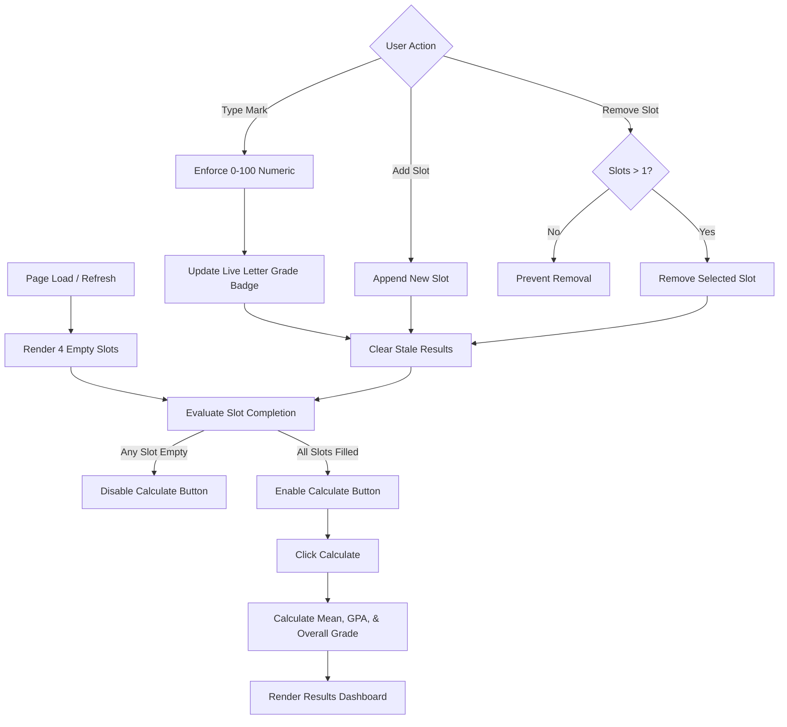

# System Design: Student Grade Management System

## 1. Overview

The **Student Grade Management System** is a lightweight, client-side, single-page web application (SPA) built using vanilla **HTML5**, **CSS3**, and **JavaScript (ES6+)**. The system allows a single student to dynamically enter subject marks, receive instantaneous per-subject letter grade feedback, and compute aggregate metrics including the mean mark, overall letter grade, and grade point average (GPA on a 4.0 scale).

The application requires zero backend infrastructure, runs entirely in the browser, maintains all state in-memory, and prioritizes strict input validation and responsive user feedback.

---

## 2. Architecture & File Structure

The project follows a standard modular, separation-of-concerns architecture with three core files:

```
Process Improvement Student Grade Management System/
├── index.html        # Semantic HTML5 document & UI structure
├── style.css         # Modern, responsive styling & visual states
├── script.js         # State management, validation, calculations, & DOM events
├── Requirements.md   # Functional requirements specification
└── Design.md         # System design document
```

### Module Responsibilities

| File | Primary Role | Key Elements |
| :--- | :--- | :--- |
| **`index.html`** | Structure & semantics | Container card, header, dynamic slots list, controls bar, and calculation results dashboard. |
| **`style.css`** | Presentation & feedback | Clean typography, responsive layout, grade badge color-coding, and disabled button states. |
| **`script.js`** | Business logic & reactivity | Input filtering, dynamic slot management, live grade translation, aggregate calculation, and staleness handling. |

---

## 3. UI / UX Design & Wireframe

### Wireframe Layout

```
+--------------------------------------------------------------+
|                Student Grade Management System               |
|         Enter subject marks (0-100) to compute your GPA       |
+--------------------------------------------------------------+
| Subject Marks:                                               |
|                                                              |
| [ Subject 1 ]  [ Mark: 92  ]  [ Grade: A ]  [ Remove (X) ]   |
| [ Subject 2 ]  [ Mark: 85  ]  [ Grade: B ]  [ Remove (X) ]   |
| [ Subject 3 ]  [ Mark: 74  ]  [ Grade: C ]  [ Remove (X) ]   |
| [ Subject 4 ]  [ Mark:     ]  [ Grade:   ]  [ Remove (X) ]   |
|                                                              |
| [+ Add Subject]                                              |
+--------------------------------------------------------------+
| [                     Calculate Results                    ] |
|                  (Disabled until all filled)                 |
+--------------------------------------------------------------+
| Results:                                                     |
|   - Average Mark: 83.67%                                     |
|   - Overall Grade: B                                         |
|   - Cumulative GPA: 3.00 / 4.00                              |
+--------------------------------------------------------------+
```

### Visual States & Components
1. **Dynamic Slot Row**:
   - **Label**: Subject number (e.g., "Subject 1", "Subject 2").
   - **Input Box**: Number input bounded strictly between `0` and `100`.
   - **Live Grade Badge**: Dynamically displays letter grade (`A`, `B`, `C`, `D`, `F`) or stays blank when empty.
   - **Remove Button**: Deletes the slot. Disabled or hidden if only one slot remains.
2. **Controls**:
   - **Add Button (`#add-slot-btn`)**: Appends a new empty slot.
   - **Calculate Button (`#calculate-btn`)**: Computes results. Enabled strictly when every existing slot contains a valid mark.
3. **Results Section (`#results-panel`)**:
   - Hidden or cleared initially and whenever input marks change post-calculation (preventing stale data).
   - Displays Average Mark (mean of marks), GPA (mean of grade points), and Overall Grade together.

---

## 4. State & Data Model

The application operates with ephemeral client-side memory:

```javascript
// State representation
const state = {
  // Array of active slot IDs or DOM node references
  slots: [],
  // Calculation result state
  isCalculated: false
};
```

### Grade & Point Mapping

The core business rules translate marks to grades and grade points:

```javascript
const GRADE_SCALE = [
  { min: 90, grade: 'A', points: 4.0 },
  { min: 80, grade: 'B', points: 3.0 },
  { min: 70, grade: 'C', points: 2.0 },
  { min: 60, grade: 'D', points: 1.0 },
  { min: 0,  grade: 'F', points: 0.0 }
];
```

---

## 5. Logic & Component Flow

### 5.1 System Data Flow



---

## 6. Detailed Implementation Specifications

### 6.1 Input Validation & Slot Rules (Req 1–7)
- **Initial Setup**: On DOM content loaded, invoke `createSlot()` 4 times.
- **Numeric-Only Constraint**:
  - The input elements will use `type="number"`, `min="0"`, `max="100"`, `step="any"`.
  - Listeners on `beforeinput` / `input` strip any non-digit / invalid characters (e.g., scientific notation `e`, negative signs `-`, or values `> 100`).
- **Slot Boundaries**:
  - `Add Slot`: Increments the list of subjects.
  - `Remove Slot`: Evaluates the slot count. If `slots.length <= 1`, the remove operation is prevented, and remove buttons are visibly disabled.

### 6.2 Live Feedback Engine (Req 8–10)
- On every `input` event in a mark field:
  - If field is empty: Live badge text is set to `""` (blank).
  - If field has a valid numeric value: Look up the corresponding letter grade in `GRADE_SCALE` and update the badge text immediately.

### 6.3 Calculation Engine (Req 13–18)
- **Calculate Button State**:
  - Function `updateCalculateButtonState()` checks `every(slot => slot.value.trim() !== '')`.
  - Sets `calculateBtn.disabled = !allFilled`.
- **Formulas**:
  - **Average Mark**:
    $$\text{Average} = \frac{\sum_{i=1}^{n} \text{mark}_i}{n}$$
  - **Grade Points**: For each mark, find the letter grade, then map to grade points ($A=4, B=3, C=2, D=1, F=0$).
  - **GPA**:
    $$\text{GPA} = \frac{\sum_{i=1}^{n} \text{points}_i}{n}$$
  - **Overall Letter Grade**: Computed by running the calculated **Average Mark** through the standard scale ($A \ge 90, B \ge 80, C \ge 70, D \ge 60, F < 60$).

### 6.4 Data Persistence & Staleness Prevention (Req 19–20)
- **Zero Storage**: No `localStorage`, `sessionStorage`, or cookies are used. Browser reload returns the application to its pristine 4-slot state.
- **Stale State Management**: Whenever any mark is modified, a slot is added, or a slot is removed:
  - The results dashboard is cleared or hidden (`resultsPanel.hidden = true`).
  - `isCalculated` resets to `false`.
  - Prevents displaying out-of-sync calculations.

---

## 7. Requirement Traceability Matrix

| Requirement ID | Requirement Summary | Architectural Component |
| :--- | :--- | :--- |
| **REQ-01** | Single-page app, one student, no login | Standalone `index.html` with client-only architecture |
| **REQ-02** | Initial 4 empty mark slots on load | `init()` calling `addSlot()` 4 times on startup |
| **REQ-03** | Add mark slot control | `#add-slot-btn` click handler creating new slot DOM element |
| **REQ-04** | Remove mark slot control | Per-row remove button removing targeted slot |
| **REQ-05** | Retain at least 1 slot | Validation check preventing removal when `slotCount === 1` |
| **REQ-06** | Numeric input only | `type="number"` + `input` filtering against non-digits |
| **REQ-07** | Strict values 0 to 100 | Range clamp / input validation discarding values `< 0` or `> 100` |
| **REQ-08** | Live letter grade to right of input | `.grade-badge` element adjacent to mark input |
| **REQ-09** | Instant update on change | `input` event listener updating letter grade in real time |
| **REQ-10** | Live letter grade blank when slot empty | Empty string assigned to `.grade-badge` when value is empty |
| **REQ-11** | Scale: A ≥ 90, B ≥ 80, C ≥ 70, D ≥ 60, F < 60 | `getLetterGrade(mark)` helper function |
| **REQ-12** | Grade point mapping: A=4, B=3, C=2, D=1, F=0 | `getGradePoints(grade)` helper function |
| **REQ-13** | Calculate disabled until all slots filled | `checkCompletion()` sets `btn.disabled = true` if any empty |
| **REQ-14** | Calculate enabled when all slots filled | `checkCompletion()` sets `btn.disabled = false` when complete |
| **REQ-15** | Display average, GPA, and overall grade together | `#results-panel` presenting all three metrics in single card |
| **REQ-16** | Average is mean of marks | `calculateAverage()` computing mathematical mean |
| **REQ-17** | GPA is mean of grade points | `calculateGPA()` computing mean of per-subject grade points |
| **REQ-18** | Overall letter grade based on average mark | `getLetterGrade(averageMark)` determining final grade |
| **REQ-19** | No data stored, refresh resets | In-memory only state; no Web Storage APIs |
| **REQ-20** | Modifying marks clears/updates results | `invalidateResults()` triggered on any input, add, or delete |

